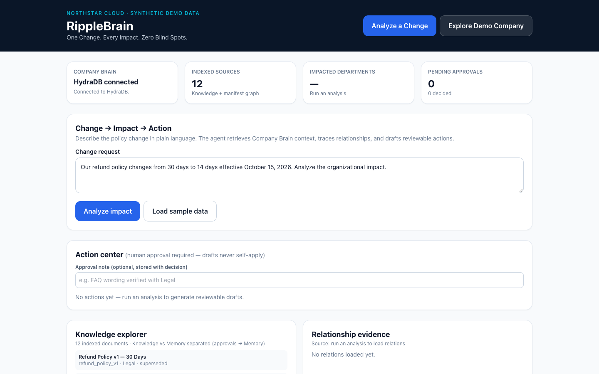
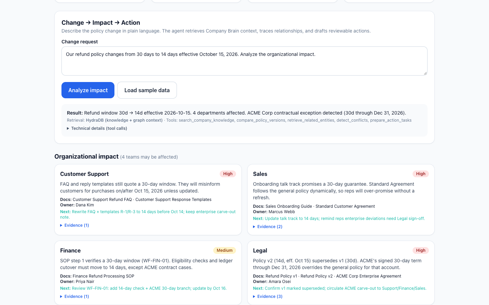
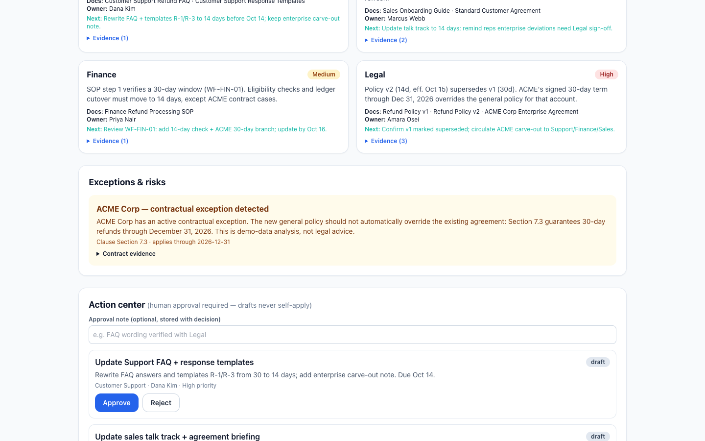
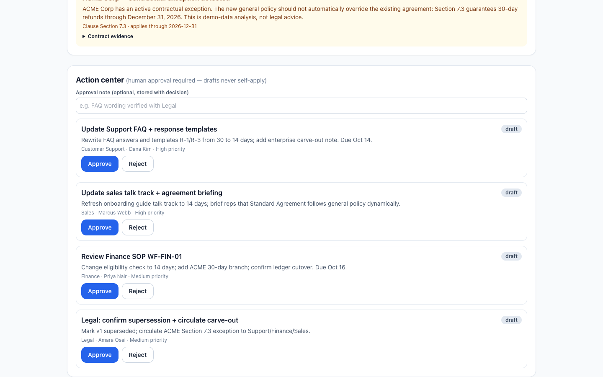
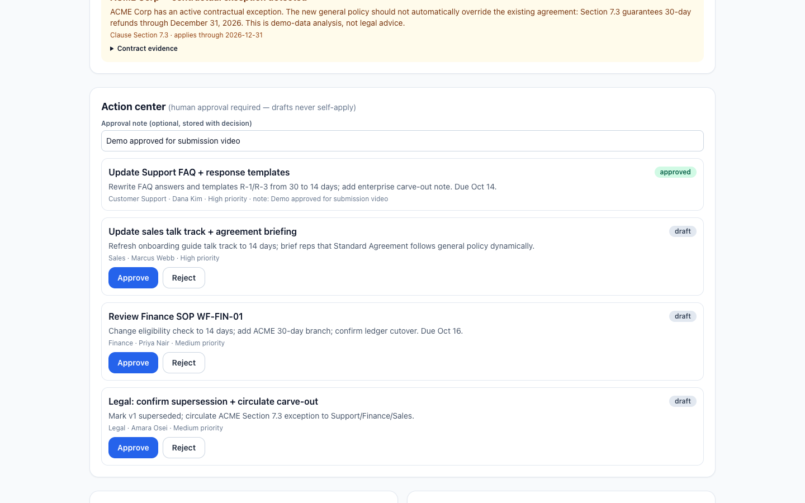
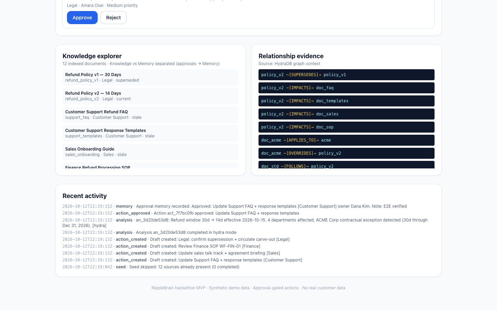
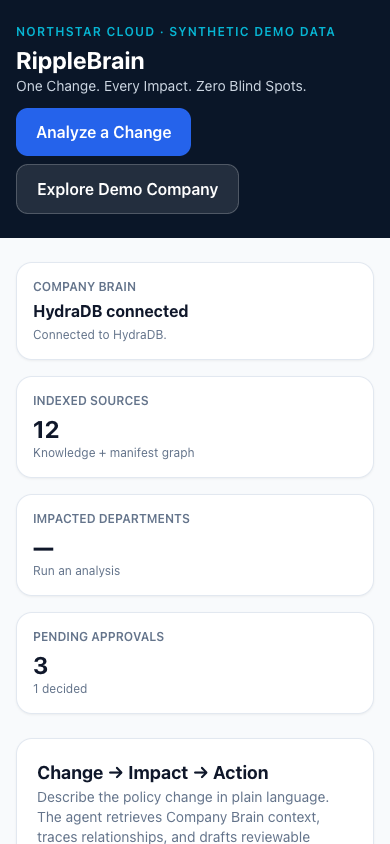

# RippleBrain — One Change. Every Impact. Zero Blind Spots.

> **Enterprise change-impact agent on your Company Brain.** Type a policy change in plain English → see every team, doc, workflow and contract it touches → catch the exceptions that must NOT change → approve human-gated follow-ups. No blind spots. No silent overwrites.

<p>
  
  
  
  
  
</p>

> 🎬 **Watch the demo (60 sec):** one refund-policy change → 4 department impacts + 1 contract exception + 4 ownable drafts → approve one. Done.

[](https://youtu.be/YcaJZ39ArTI)

*Click the thumbnail to play on YouTube — [`youtu.be/YcaJZ39ArTI`](https://youtu.be/YcaJZ39ArTI). Try it yourself with: `Our refund policy changes from 30 days to 14 days effective October 15, 2026. Analyze the organizational impact.`*

<details>
<summary>Can't play YouTube? Use the local demo file</summary>

<video src="submission-assets/demo.mp4" controls width="100%"></video>

Open [`submission-assets/demo.mp4`](submission-assets/demo.mp4).
</details>

*All data below is the fictional **Northstar Cloud** demo company — 100% synthetic. Demo analysis is not legal advice.*

---

## The 10-second mental model

- **HydraDB = the brain.** It stores the company's knowledge and memories and finds them when asked.
- **RippleBrain = the employee.** It takes what the brain retrieves, analyzes the impact, and proposes the work.
- **An app shell (e.g. Digo App-Starter) = the office.** In a real deployment that's where employees log in and process tasks; RippleBrain is the analysis engine inside it.

### How it plays out on the Northstar refund change

1. **User:** *"If we change the refund policy, which departments are affected?"*
2. **HydraDB** searches company documents and relationships → returns the refund policies, Support FAQ, ACME contract, and related owners.
3. **RippleBrain's analysis engine** reasons over those retrieved documents → identifies Support / Sales / Finance / Legal impacts and detects the ACME contract exception.
4. **Tasks + human approval:** FAQ updates, talk-track refresh, SOP review, legal carve-out circulation are proposed as drafts; nothing takes effect until a human approves.
5. **HydraDB Memory** stores the approved decision and reuses it in the next analysis — the brain gets smarter without rewriting what it knows.

---

## Why judges should care in 20 seconds

Policy changes don't fail because people disagree. They fail because **Support FAQs, sales talk tracks, finance SOPs and signed contracts drift out of sync** — and nobody sees the blast radius until a customer is misled or a contract is breached.

Generic RAG answers questions. RippleBrain drives outcomes:

| Generic RAG | RippleBrain |
|---|---|
| "What is the refund policy?" | **"We are changing it — who breaks, what must update, who owns it?"** |
| One answer, no owners | 4 impacts with severity + owner + affected docs + next step |
| Contracts treated as text | Contracts treated as constraints — **ACME's signed 30-day term (Sec 7.3 through Dec 31, 2026) is never auto-overridden** |
| Auto-act, hope for the best | **Drafts only. Human approves. State flips in SQLite. Memory records it. Knowledge is never silently overwritten.** |
| Black-box retrieval | Every run labels `retrieval_mode: hydra | local` and shows its tool calls |

**The money slide:** one 30→14 day change → Support High, Sales High, Finance Medium, Legal High — each with cited excerpts, not vibes.



*Above: the starting line. HydraDB connected, 12 sources, zero pending approvals. One textarea stands between you and the full blast radius.*

---

## Watch it work: Change → Impact → Exception → Action → Approval

### 1. Describe the change in plain language
No forms. No query DSL. The agent retrieves Company Brain context, traces relationships, and drafts reviewable actions.

### 2. Read the blast radius — 4 teams, severity-ranked, evidence-attached
Each impact names affected documents, the owner, the recommended fix, and expandable evidence excerpts. Unverified items are labeled, never invented.



*Customer Support High ("will misinform customers on/after Oct 15"), Sales High ("will over-promise"), Finance Medium (WF-FIN-01 branch), Legal High (v2 supersedes v1). Retrieval line reads: `HydraDB hybrid retrieval — active · Graph context — 15 relation path(s) returned`.*

### 3. The moment that wins demos: the contract exception
This is where "smart search" becomes "enterprise-grade". ACME Corp has an **active contractual exception** — the new general policy must not automatically override it.



> *ACME Corp — contractual exception detected. Section 7.3 guarantees 30-day refunds through December 31, 2026. This is demo-data analysis, not legal advice.*

Every exception carries clause + date + contract evidence. The `detect_conflicts` gate is mandatory — actions can't draft without it.

### 4. Approve like an operator, not a chatbot user
Four drafts appear with department, owner, priority. Nothing self-applies. Add an optional note, hit Approve/Reject, watch real state flip.

Before — 4 drafts waiting:



After — note persisted, status flipped, audit intact:



*`Demo approved for submission video` → `approved` pill, note stored with the decision, remaining 3 still draft. Idempotency keys mean re-runs and double-clicks create zero duplicates.*

### 5. Trust it: Knowledge explorer + Relationship evidence + Activity
Knowledge vs Memory are visually separated (approvals → Memory, never Knowledge overwrites). Relations show their provenance. Activity logs every seed, analysis, draft, and approval.



*Left: 12 indexed docs with status (`current / superseded / stale`). Right: live HydraDB graph context — `policy_v2 —[SUPERSEDES]→ policy_v1`, `[IMPACTS]→ doc_faq/templates/sales/sop`, `doc_acme —[OVERRIDES]→ policy_v2`. Bottom: full audit trail with retrieval mode stamped per analysis.*

Mobile? Fully responsive — same flow at 390px, no overflow, zero console errors:



---

## HydraDB integration — not a logo, a load-bearing wall

Built on `hydradb-sdk` v2 API per the official Company Brain guide, verified live on 2026-10-12:

- **Provisioning:** `databases.create` + `databases.status` with bounded waits (no infinite retries) → `ripplebrain_demo` ready for ingestion
- **Ingestion:** `context.ingest` × 12 with `type="knowledge"` + `document_metadata` + `graph_payload` BYO graph (SUPERSEDES / IMPACTS / OVERRIDES / APPLIES_TO / FOLLOWS / APPROVED_BY / ASSIGNED_TO / OWNED_BY with evidence contexts)
- **Retrieval:** `query` with `query_by="hybrid"`, `mode="thinking"` + `graph_context=True` vs `False` baseline; chunks + `query_paths` + `chunk_relations` parsed and threaded to the UI
- **Memory:** `context.ingest` with `type="memory"` for approvals; `type="all"` recall verified cross-session
- **Status:** `context.status` polling, `context.list` / `relations` / `inspect` for diagnosis

**Live numbers (not aspirations):**
- 12/12 sources ingested and confirmed via `context.list`
- Live hybrid retrieval ranks Refund Policy v2 first for the demo query → drives the full analysis (`retrieval_mode: hydra`)
- `relations(id=12_workflow_manifest)` returns **120 triplets** incl. our BYO predicates
- Demo analysis serves **15 `chunk_relations`** incl. `refund policy v2 —[supersedes]→ refund policy v1`
- Indexing observed honestly: manifest reached `completed`, rest `queued`/`graph_creation` — UI reports per-run counts and otherwise shows *"Graph indexing — pending"*

### What HydraDB actually does here (3 jobs)

| Job | What it means | Status in this demo |
|---|---|---|
| **Knowledge** | Semantic + keyword search over company documents | ✅ Verified — 12/12 demo docs searchable, Refund Policy v2 ranked first |
| **Graph** | Relationships between policies, contracts, docs, owners | 🟡 Partially verified — relation data stored (120 triplets), `chunk_relations` served live (15 paths); full `query_paths` coverage pending indexing |
| **Memory** | Past decisions stored and re-retrieved for future analyses | ✅ Verified — approvals stored and re-queried across sessions |

### The distinction that matters

HydraDB never decides *"Support must rewrite the FAQ."* It **finds and provides the relevant FAQ and policy**; RippleBrain's analysis logic **generates the conclusion** from them. Likewise, the verified RippleBrain here runs primarily on a **rule-based planner** (OpenAI function-calling only when keyed) — so don't pitch it as a fully autonomous LLM judging your company. The intelligence is in grounded retrieval + explicit conflict gates, not magic.

### Why not just SQLite or plain RAG?

SQLite alone can store policy text and approval rows just fine. But semantic search, document linking, and recalling past decisions would each need separate hand-built systems. HydraDB provides all three as one service. Honest caveat: **at this demo's 12-document scale we claim no performance edge** — the payoff is operational: when this grows to thousands of policies, contracts, and decision records, search and memory stay managed in one place instead of three DIY stacks.

> **One-line version:** HydraDB is the foundation that owns knowledge, relationships, and memory; RippleBrain is the application that turns that foundation into real company work.

**Honest fallback:** without `HYDRA_DB_API_KEY`, the app runs a transparent local keyword hybrid over `data/company/*.md` + `data/relationships/graph.json` — always labeled `retrieval_mode: local`, never presented as HydraDB. Seed: `backend/.venv/bin/python scripts/seed_company.py` · Verify: `backend/.venv/bin/python scripts/verify_hydradb.py`.

---

## Agentic workflow — conditional tools, visible reasoning

```
[Next.js UI] --REST--> [FastAPI /api/*] --> [Orchestrator]
                                                ├─ search_company_knowledge (HydraDB query or local hybrid)
                                                ├─ retrieve_related_entities (Hydra graph paths or manifest graph)
                                                ├─ compare_policy_versions (regex + date extraction)
                                                ├─ detect_conflicts (stale-doc + contract-override rules, injection scan) ← mandatory gate
                                                ├─ prepare_action_tasks (idempotent drafts → SQLite)
                                                └─ record_approved_decision (HydraDB memory or local memory)
```

- **Planner:** OpenAI function-calling when `OPENAI_API_KEY` is set, otherwise a conditional rule planner that selects a real subset per request — never a fixed script.
- **Safety gates:** insufficient-evidence refusal (won't fabricate impacts for out-of-corpus queries), mandatory conflict detection before drafting, draft-only writes, `draft → approved/rejected` transitions only.
- **Transparency:** selected tools + execution log rendered in the UI under "Technical details (tool calls)". Prompt-injection bait in docs is flagged as *"Untrusted instruction ignored"* — treated as data, never executed.

See [`docs/architecture.md`](docs/architecture.md).

---

## QA that survived contact with a live API

Full log: [`docs/evaluation.md`](docs/evaluation.md). Demo script: [`docs/demo-script.md`](docs/demo-script.md).

| Check | Command | Result |
|---|---|---|
| Backend tests (local) | `backend/.venv/bin/python -m pytest backend/tests -q` | **14 passed** |
| Backend tests (live HydraDB) | same | **12 passed + 2 skipped** (skips are local-window-specific) |
| TypeScript | `tsc --noEmit` | clean |
| Lint | `next lint` | clean |
| Production build | `npm run build` | OK |
| Browser E2E (Playwright, desktop + 390px mobile) | approve + reload persistence, activity, memory | **14/14, zero console errors** |
| API smoke | health → seed → analyze → approve → activity | all OK |

Bugs found and fixed during QA (the good kind): fabricated impacts for unrelated queries → evidence gate; duplicate actions on re-run → content-based idempotency; injection bait out of live chunk window → quarantine snippet + disclosure; `document_metadata` 400 → title moved to `additional_metadata`; dropped `chunk_relations` → parser fix that unlocked the 15-path graph view above. LLM synthesis remains NOT VERIFIED (no `OPENAI_API_KEY` in test env) — stated, not hidden.

---

## Run it yourself (3 minutes)

```bash
cp .env.example .env   # add HYDRA_DB_API_KEY and OPENAI_API_KEY — both optional
uv venv backend/.venv --python 3.11
uv pip install --python backend/.venv/bin/python -r backend/requirements.txt
backend/.venv/bin/uvicorn app.main:app --app-dir backend --port 8000
cd frontend && npm install && NEXT_PUBLIC_API_URL=http://localhost:8000 npm run dev
```

Open http://localhost:3000 → **Load sample data** → keep the prefilled refund change → **Analyze impact** → approve one action with a note → check Knowledge explorer + Relationship evidence + Recent activity.

**Tech:** Next.js 14, React 18, TypeScript, Tailwind · Python 3.11, FastAPI, Pydantic, HydraDB SDK, OpenAI (optional), SQLite · pytest, tsc, Next build, Playwright.

---

## SaaS shell: Digo App-Starter integration

RippleBrain also runs inside a Digo App-Starter workspace (MIT-licensed,
https://github.com/digohq/app-starter, vendored under `app-starter/`).

- **Used for real**: App-Starter authentication (email+password login), organization
  workspaces with OWNER/ADMIN/MEMBER roles, NestJS API, Next.js UI.
- **New vertical** (Projects-shaped, one slice): Prisma `RippleBrainRun` audit model
  + migration; NestJS `ripplebrain` module (`analyze`, `approve`, `reject`, `runs`)
  that checks organization membership/role server-side (foreign org → 404,
  member approve → 403) and proxies to the FastAPI engine with an internal
  service token; shared types in `packages/shared`; `ripplebrain-api.ts`
  client; `organizations/[organizationId]/ripplebrain` page built from the
  starter's `components/ui`; org-home entry card.
- **Engine untouched**: FastAPI + HydraDB Knowledge/Graph/Memory + SQLite run as
  before on :8000. When `INTERNAL_API_TOKEN` is set, FastAPI compute/mutation
  routes require the `X-Internal-Token` header, so the engine cannot be driven
  anonymously around organization auth. Unset = open local development (that is
  how the standalone :3000 demo runs).
- **Demo scope (stated, not claimed)**: single-organization demo; the engine's
  HydraDB/SQLite stores are shared, while *access* is org-gated and every run
  is audited per organization in Postgres. No per-tenant engine data isolation
  is claimed.

| Service | URL |
|---|---|
| SaaS web (login → org → RippleBrain) | http://localhost:3010 (`owner@example.com` / `Password123!`) |
| NestJS API + Swagger | http://localhost:3011, `/api/docs` |
| FastAPI engine (gated, for SaaS) | http://localhost:8001 (`INTERNAL_API_TOKEN` enforced) |
| FastAPI engine (open, local dev/standalone :3000 demo) | http://localhost:8000 (`INTERNAL_API_TOKEN` unset) |

```bash
brew services start postgresql@15 redis  # or Docker Compose per app-starter README
cd app-starter && pnpm install
pnpm --filter @app-starter/api exec prisma migrate deploy
pnpm --filter @app-starter/api run prisma:seed
pnpm --filter @app-starter/shared build
pnpm --filter @app-starter/api dev   # :3011 (needs RIPPLEBRAIN_* in apps/api/.env)
pnpm --filter @app-starter/web dev   # :3010
```

---

## Limitations (stated upfront) → Roadmap (worth funding)

- Local fallback is keyword-based, not vector search → HydraDB hybrid is the default when keyed.
- LLM synthesis needs `OPENAI_API_KEY`; otherwise deterministic rules apply (still grounded, still gated).
- Single-organization SaaS demo: auth + org roles + per-org audit via App-Starter; engine stores shared (see SaaS scope note above).
- **Next:** full graph-context comparison once indexing completes, Slack/Jira/Confluence connectors, role-based memories, multi-policy scenarios, calibrated confidence, Jira/Notion action sync.

---

*RippleBrain hackathon MVP · Synthetic demo data · Approval-gated actions · No real customer data.*
